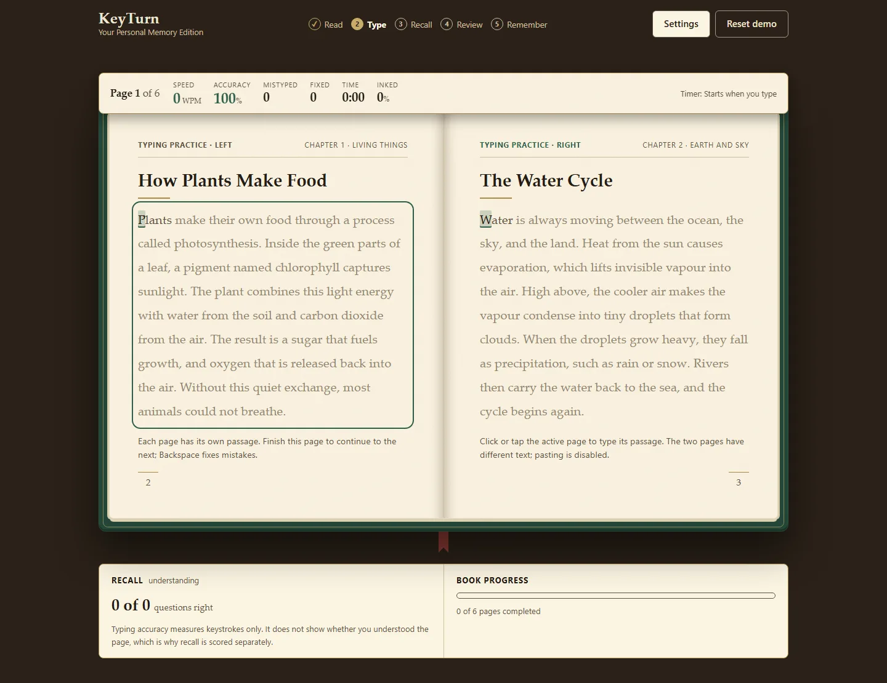

<picture>
  <source media="(max-width: 600px)" srcset="assets/hero-mobile.svg">
  
</picture>

I'm **Shubh Raghav**. I build interactive web products and native Android tools, with an interest in **clear state, useful feedback and thoughtful interface design**.

**[Try KeyTurn](https://bookdesign-wine.vercel.app)** · **[Open For You](https://shubhraghavt-57.github.io/Gift-for-Soemeone/)** · [Engineering notes](docs/project-notes.md)

## Selected projects

### [KeyTurn — Personal Memory Edition](https://github.com/SHUBHRAGHAVT-57/bookdesign)

A browser study prototype combining original reading passages, typing practice, recall questions and targeted word review. Deterministic scoring makes its decisions inspectable; versioned browser storage and a service worker support local progress and offline use after the first production visit.

**Engineering focus:** explicit study-state transitions, local persistence and testable scoring. Progress belongs to the current browser; improved learning outcomes remain an unmeasured hypothesis.

`React` · `TypeScript` · `Vite` · `Vitest` · `Playwright`

**[Live demo](https://bookdesign-wine.vercel.app)** · [Public source: bookdesign](https://github.com/SHUBHRAGHAVT-57/bookdesign) · [Scoring decisions](https://github.com/SHUBHRAGHAVT-57/bookdesign#how-echo-review-picks-a-word) · [Evidence and limits](https://github.com/SHUBHRAGHAVT-57/bookdesign/blob/main/docs/IMPACT.md)

### [Lensqivo](https://github.com/SHUBHRAGHAVT-57/Lensqivo)

A native Android camera with still-photo and video capture, original color looks and restrained beauty controls. Kotlin, Jetpack Compose and CameraX sit above a Java capture-state and color-math core.

**Engineering focus:** capture ownership through finalization, recovery of interrupted originals and a shared SDR effects path. This is a development build; physical-camera quality, codec behavior and preview/output parity still need device qualification.

[Build and evaluate](https://github.com/SHUBHRAGHAVT-57/Lensqivo#build-it) · [Technical decisions](https://github.com/SHUBHRAGHAVT-57/Lensqivo/blob/main/docs/research.md) · [Validation record](https://github.com/SHUBHRAGHAVT-57/Lensqivo/blob/main/docs/validation.md)

### [SyncVerse](https://github.com/SHUBHRAGHAVT-57/syncverse)

A collaborative Markdown workspace with live editing, presence, browser-local persistence and export. React and TypeScript provide the interface; Yjs, CodeMirror and IndexedDB manage shared and local document state.

**Engineering focus:** merging concurrent edits while separating local persistence from relay delivery. The included relay is for local development; authentication and production access control are outside the prototype.

[Run a two-browser session](https://github.com/SHUBHRAGHAVT-57/syncverse#run-locally) · [Architecture](https://github.com/SHUBHRAGHAVT-57/syncverse/blob/main/docs/ARCHITECTURE.md) · [Security boundaries](https://github.com/SHUBHRAGHAVT-57/syncverse/blob/main/docs/SECURITY.md)

### [For You](https://github.com/SHUBHRAGHAVT-57/Gift-for-Soemeone)

Create a procedural particle rose or proposal ring, add a note and share a recipient reveal. A static TypeScript and Three.js app with preview, replay, reduced-motion support and a graphics fallback.

**Engineering focus:** Unicode-safe share links, browser-history behavior and meaningful content outside the canvas. The note is encoded in the link, not encrypted; anyone with the full link can read it.

**[Live demo](https://shubhraghavt-57.github.io/Gift-for-Soemeone/)** · [Source and sharing model](https://github.com/SHUBHRAGHAVT-57/Gift-for-Soemeone#create-a-gift) · [Rendering and accessibility](https://github.com/SHUBHRAGHAVT-57/Gift-for-Soemeone#accessibility-and-rendering)

### [Algorithmic Lab](https://github.com/SHUBHRAGHAVT-57/algorithmic-lab)

A Python algorithm collection with explicit contracts, complexity notes and edge-case tests. The public implementations cover Two Sum, maximum subarray, lower bound and BFS shortest paths.

**Engineering focus:** small reference implementations whose behavior can be checked against explicit contracts and edge-case tests.

[Implementations](https://github.com/SHUBHRAGHAVT-57/algorithmic-lab#implemented-algorithms) · [Run the tests](https://github.com/SHUBHRAGHAVT-57/algorithmic-lab#run-tests)

## Tools in context

**Web:** TypeScript, JavaScript, React, Vite, HTML and CSS. **Android:** Kotlin, Java, Jetpack Compose and CameraX. **Data and collaboration:** Yjs, CodeMirror, IndexedDB and browser storage. **Checks:** Vitest, Playwright, Python unittest and GitHub Actions.

These tools are represented in the linked projects; source-language shares below describe repository bytes, not proficiency.

## Project discussion

For questions, reproducible bugs or contributions, use the project's issue tracker.

[KeyTurn issues](https://github.com/SHUBHRAGHAVT-57/bookdesign/issues) · [Lensqivo issues](https://github.com/SHUBHRAGHAVT-57/Lensqivo/issues) · [SyncVerse issues](https://github.com/SHUBHRAGHAVT-57/syncverse/issues) · [For You issues](https://github.com/SHUBHRAGHAVT-57/Gift-for-Soemeone/issues) · [Algorithmic Lab issues](https://github.com/SHUBHRAGHAVT-57/algorithmic-lab/issues)

Public code snapshot and contribution calendar

<picture>
  <source media="(prefers-color-scheme: dark)" srcset="assets/stats-dark.svg">
  
</picture>

<!-- public-stats:start -->
Updated **2026-11-19 UTC**: **6 public repositories**, **0 stars**.

TypeScript: 54.7% · Kotlin: 23.1% · CSS: 13.1% · JavaScript: 5.2% · HTML: 1.6% · Java: 1.4% · Python: 0.5% · GLSL: 0.4%
<!-- public-stats:end -->

Languages use GitHub's source-byte counts across public, non-fork repositories. Generated assets retain the last successful snapshot if an API update fails.

[Snapshot data](data/public-profile.json) · [Current public repositories](https://github.com/SHUBHRAGHAVT-57?tab=repositories)

<picture>
  <source media="(prefers-reduced-motion: reduce) and (prefers-color-scheme: dark)" srcset="assets/contributions-dark.svg">
  <source media="(prefers-reduced-motion: reduce)" srcset="assets/contributions-light.svg">
  <source media="(prefers-color-scheme: dark)" srcset="assets/snake-dark.svg">
  
</picture>

Generated with <a href="https://github.com/Platane/snk">Platane/snk</a>. Contribution levels are not a measure of software quality.

