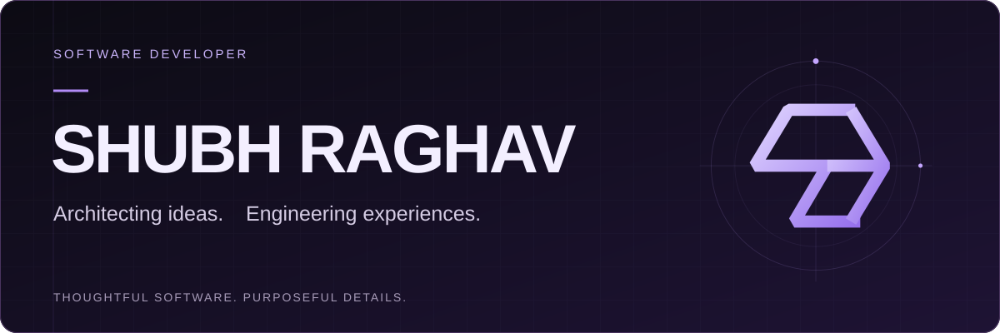
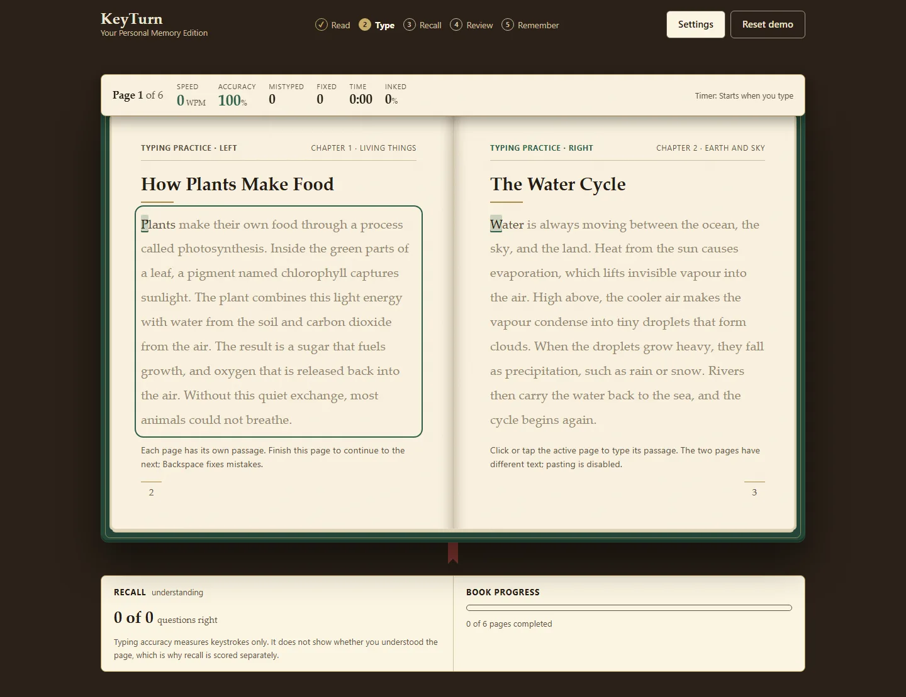
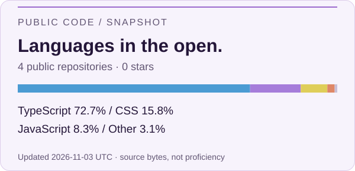

<picture>
  <source media="(max-width: 600px)" srcset="assets/hero-mobile.svg">
  
</picture>

<strong>Software Developer · Web & Android</strong>

  
  
  

## About

I'm **Shubh Raghav**. I build interactive web products and native Android experiences, with an interest in the space between **solid engineering and thoughtful design**.

My public projects explore active study with **KeyTurn**, native camera controls with **Lensqivo**, collaborative writing with **SyncVerse**, and algorithms with **Algorithmic Lab**. I care about clear state, useful feedback, local persistence, and interfaces that make their behavior easy to understand.

## Technology

**Languages**

  
  
  
  

**Interface & development**

  
  
  

**Testing**

  
  

Also used in my public projects: **Kotlin**, **Java**, **Jetpack Compose** and **CameraX** for Android; **Yjs**, **CodeMirror** and **IndexedDB** for collaboration; **Python** for algorithms; and **localStorage**, **service workers** and **Web Audio** for KeyTurn.

## Featured work

### [KeyTurn — Personal Memory Edition](https://github.com/SHUBHRAGHAVT-57/bookdesign)

**Read. Type. Recall. Review.** A browser-based experiment in making study material more interactive.

KeyTurn pairs original reading passages with typing practice, short recall questions, and targeted fill-in-the-blank reviews. Progress stays in the browser; the production app supports offline use after its first online load.

- **Built for interaction:** live typing feedback, page transitions, recall questions, and a final memory report.
- **Designed to persist:** versioned browser storage and offline support after the first production visit.
- **Engineering in the open:** deterministic scoring, explicit state transitions, unit tests, and Playwright scenarios.

`TypeScript` · `React` · `Vite` · `CSS` · `Vitest` · `Playwright`

**[Try the demo](https://bookdesign-wine.vercel.app)** · [Explore the source](https://github.com/SHUBHRAGHAVT-57/bookdesign) · [Read the engineering notes](https://github.com/SHUBHRAGHAVT-57/bookdesign#structure)

Engineering notes & limitations

The public repository includes unit tests and Playwright scenarios for the demo flow, persistence, accessibility, and viewport layouts. Learning outcomes are a hypothesis, not a measured claim. Recall grading uses explicit keywords; progress is local to the current browser.

### More public projects

#### [Lensqivo](https://github.com/SHUBHRAGHAVT-57/Lensqivo)

An Android camera with native photo/video capture, live color looks and restrained beauty controls. Built with Kotlin, Jetpack Compose, CameraX and a Java core. Development build; physical-camera qualification is pending.

#### [SyncVerse](https://github.com/SHUBHRAGHAVT-57/syncverse)

A collaborative Markdown workspace with live editing, presence, local persistence and export. React, TypeScript, Yjs, CodeMirror and IndexedDB. Prototype with a local development relay; production access control is not included.

#### [Algorithmic Lab](https://github.com/SHUBHRAGHAVT-57/algorithmic-lab)

Python algorithms with documented contracts and edge-case tests: Two Sum, Kadane's algorithm, lower bound and BFS shortest paths.

Each repository documents its setup and limitations. These are personal projects; production readiness and measured learning outcomes are not assumed.

## GitHub activity

<picture>
  <source media="(prefers-color-scheme: dark)" srcset="assets/stats-dark.svg">
  
</picture>

Snapshot numbers and methodology

<!-- public-stats:start -->
Updated **2026-11-11 UTC**: **6 public repositories**, **0 stars**.

TypeScript: 54.7% · Kotlin: 23.1% · CSS: 13.1% · JavaScript: 5.2% · HTML: 1.6% · Java: 1.4% · Python: 0.5% · GLSL: 0.4%
<!-- public-stats:end -->

Languages are measured by GitHub's source-byte counts across public, non-fork repositories. They describe the code in those repositories, not proficiency or time spent coding. Generated assets remain available if an API update fails.

[Snapshot data](data/public-profile.json) · [Current public repositories](https://github.com/SHUBHRAGHAVT-57?tab=repositories)

### Contribution rhythm

<picture>
  <source media="(prefers-reduced-motion: reduce) and (prefers-color-scheme: dark)" srcset="assets/contributions-dark.svg">
  <source media="(prefers-reduced-motion: reduce)" srcset="assets/contributions-light.svg">
  <source media="(prefers-color-scheme: dark)" srcset="assets/snake-dark.svg">
  
</picture>

A playful view of the contribution calendar, generated with <a href="https://github.com/Platane/snk">Platane/snk</a>. Meaningful work matters more than a streak.

## Connect

For project questions or reproducible bugs, use the relevant issue tracker:

- [KeyTurn issues](https://github.com/SHUBHRAGHAVT-57/bookdesign/issues)
- [Lensqivo issues](https://github.com/SHUBHRAGHAVT-57/Lensqivo/issues)
- [SyncVerse issues](https://github.com/SHUBHRAGHAVT-57/syncverse/issues)
- [Algorithmic Lab issues](https://github.com/SHUBHRAGHAVT-57/algorithmic-lab/issues)

[Explore my GitHub](https://github.com/SHUBHRAGHAVT-57) · [See the project roadmap](https://github.com/SHUBHRAGHAVT-57/bookdesign/blob/main/docs/ROADMAP.md)

---

