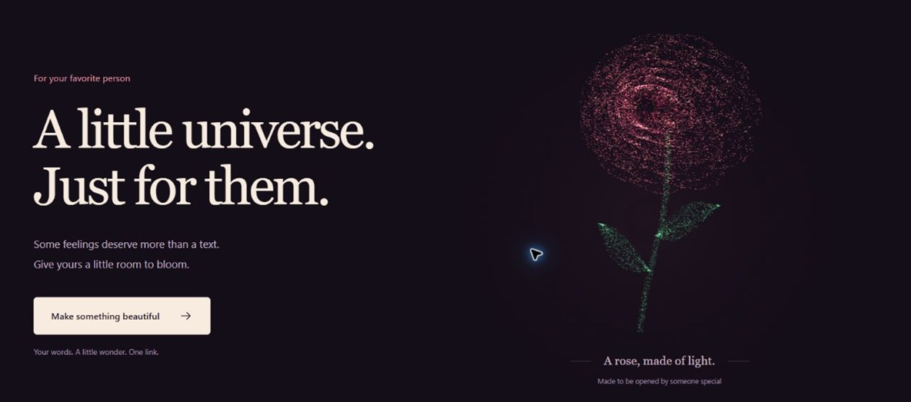
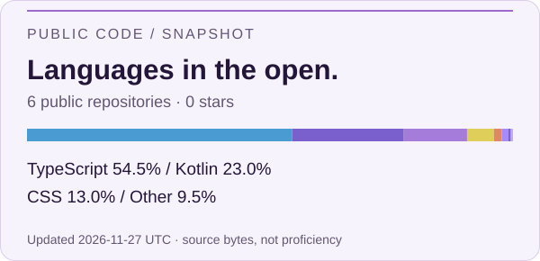

<picture>
  <source media="(max-width: 600px)" srcset="assets/hero-mobile.svg">
  
</picture>

<strong>Software Developer · Web & Android</strong>

  
  
  

## About

I’m **Shubh Raghav**. I build interactive web apps and Android tools. Two projects I’ve spent time on are **KeyTurn**, a study book that remembers which words tripped you up, and **Lensqivo**, a camera that lets you try a color treatment before you take the shot.

## Skills

**Languages**

  
  
  
  
  
  

**Interface & development**

  
  
  

**Android & graphics**

  
  
  

**Testing**

  
  

## Featured work

### [KeyTurn · Personal Memory Edition](https://github.com/SHUBHRAGHAVT-57/bookdesign)

Type a passage into a two-page book, then answer a recall question. KeyTurn uses corrections and long pauses to choose words for a later fill-in-the-blank review. Close the tab and your place is saved in the browser.

**[Open the study book](https://bookdesign-wine.vercel.app)** · [How word review works](https://github.com/SHUBHRAGHAVT-57/bookdesign#how-echo-review-picks-a-word)

### [Lensqivo](https://github.com/SHUBHRAGHAVT-57/Lensqivo)

A native Android camera with eight live color looks. You can dial in the strength of a look or compare it with the original before shooting. If a full-resolution edit fails, the app saves the original photo.

  
  
  

Emulator screenshots of the camera, color looks, and beauty controls. The scene is a test image.

[Build Lensqivo](https://github.com/SHUBHRAGHAVT-57/Lensqivo#build-it) · [Camera testing notes](https://github.com/SHUBHRAGHAVT-57/Lensqivo/blob/main/docs/validation.md)

### [For You](https://github.com/SHUBHRAGHAVT-57/Gift-for-Soemeone)

Write a note, choose a rose or a ring, and share the reveal. I used Three.js to draw the shapes with particles. A still version is available for people who prefer reduced motion.

  <a href="https://shubhraghavt-57.github.io/Gift-for-Soemeone/">
    <picture>
      <source media="(max-width: 600px)" srcset="assets/for-you-rose.jpg">
      
    </picture>
  </a>

**[Try the reveal](https://shubhraghavt-57.github.io/Gift-for-Soemeone/)** · [Explore the source](https://github.com/SHUBHRAGHAVT-57/Gift-for-Soemeone)

### More projects

- **[SyncVerse](https://github.com/SHUBHRAGHAVT-57/syncverse)** pairs a shared Markdown editor with local storage. Two writers can disconnect from the local relay, keep typing, and merge their edits when they reconnect. [Architecture](https://github.com/SHUBHRAGHAVT-57/syncverse/blob/main/docs/ARCHITECTURE.md)
- **[Algorithmic Lab](https://github.com/SHUBHRAGHAVT-57/algorithmic-lab)** is where I keep Python implementations of algorithms, with complexity notes and tests for edge cases.

## GitHub activity

<picture>
  <source media="(prefers-color-scheme: dark)" srcset="assets/stats-dark.svg">
  
</picture>

Snapshot numbers and methodology

<!-- public-stats:start -->
Updated **2026-11-20 UTC**: **6 public repositories**, **0 stars**.

TypeScript: 54.7% · Kotlin: 23.1% · CSS: 13.1% · JavaScript: 5.2% · HTML: 1.6% · Java: 1.4% · Python: 0.5% · GLSL: 0.4%
<!-- public-stats:end -->

Languages are measured by GitHub's source-byte counts across public, non-fork repositories. They describe the code in those repositories, not proficiency or time spent coding. Generated assets remain available if an API update fails.

[Snapshot data](data/public-profile.json) · [Current public repositories](https://github.com/SHUBHRAGHAVT-57?tab=repositories)

### Contribution rhythm

<picture>
  <source media="(prefers-reduced-motion: reduce) and (prefers-color-scheme: dark)" srcset="assets/contributions-dark.svg">
  <source media="(prefers-reduced-motion: reduce)" srcset="assets/contributions-light.svg">
  <source media="(prefers-color-scheme: dark)" srcset="assets/snake-dark.svg">
  
</picture>

Contribution animation by <a href="https://github.com/Platane/snk">Platane/snk</a>.

## Connect

For project questions or reproducible bugs, use the relevant issue tracker:

- [KeyTurn issues](https://github.com/SHUBHRAGHAVT-57/bookdesign/issues)
- [Lensqivo issues](https://github.com/SHUBHRAGHAVT-57/Lensqivo/issues)
- [SyncVerse issues](https://github.com/SHUBHRAGHAVT-57/syncverse/issues)
- [For You issues](https://github.com/SHUBHRAGHAVT-57/Gift-for-Soemeone/issues)
- [Algorithmic Lab issues](https://github.com/SHUBHRAGHAVT-57/algorithmic-lab/issues)

[Explore my GitHub](https://github.com/SHUBHRAGHAVT-57) · [See the project roadmap](https://github.com/SHUBHRAGHAVT-57/bookdesign/blob/main/docs/ROADMAP.md)

---

